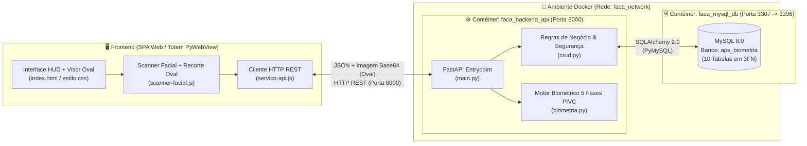

# 🛡️ F.A.C.A. — Frente de Autenticação e Controle de Acesso


> **Sistema de Identificação e Autenticação Biométrica Multifator (MFA) com Visão Computacional**  
> **Atividades Práticas Supervisionadas (APS) — 6º Semestre de Ciência da Computação — UNIP (2026/2)**  
> **Disciplina Base:** Processamento de Imagem e Visão Computacional (PIVC)

---

## 📑 Sumário

1. [Informações Acadêmicas e Equipe](#-1-informações-acadêmicas-e-equipe)
2. [Visão Geral do Projeto](#-2-visão-geral-do-projeto)
3. [Linguagens de Programação e Tecnologias Utilizadas](#-3-linguagens-de-programação-e-tecnologias-utilizadas)
4. [Arquitetura e Fluxo de Funcionamento](#-4-arquitetura-e-fluxo-de-funcionamento)
5. [Como Funciona a Biometria Facial (Região Oval + 5 Fases do PIVC)](#-5-como-funciona-a-biometria-facial-região-oval--5-fases-do-pivc)
6. [Níveis de Acesso (RBAC Cumulativo) e Regras de Segurança](#-6-níveis-de-acesso-rbac-cumulativo-e-regras-de-segurança)
7. [Credenciais Prontas para Teste (Seeds Oficiais)](#-7-credenciais-prontas-para-teste-seeds-oficiais)
8. [Modelagem do Banco de Dados Relacional (MySQL 8.0 em 3FN)](#-8-modelagem-do-banco-de-dados-relacional-mysql-80-em-3fn)
9. [Estrutura de Pastas e Arquivos](#-9-estrutura-de-pastas-e-arquivos)
10. [Como Executar o Projeto (Passo a Passo)](#-10-como-executar-o-projeto-passo-a-passo)
11. [Documentação dos Endpoints da API RESTful](#-11-documentação-dos-endpoints-da-api-restful)
12. [Testes Automatizados (E2E e Diagnóstico)](#-12-testes-automatizados-e2e-e-diagnóstico)
13. [Solução de Problemas Comuns (Troubleshooting)](#-13-solução-de-problemas-comuns-troubleshooting)
14. [Estrutura do Trabalho Escrito (ABNT / Manual UNIP)](#-14-estrutura-do-trabalho-escrito-abnt--manual-unip)

---

## 🎓 1. Informações Acadêmicas e Equipe

| Item | Especificação |
| :--- | :--- |
| **Instituição** | Universidade Paulista (UNIP) |
| **Curso** | Bacharelado em Ciência da Computação — 6º Semestre |
| **Semestre Letivo** | 2026/2 |
| **Disciplina Principal** | Processamento de Imagem e Visão Computacional (PIVC) |
| **Tema Oficial** | Frente de Autenticação e Controle de Acesso — **F.A.C.A.** |

### 👥 Integrantes do Grupo

| Integrante | RA | Responsabilidade Técnica Principal |
| :--- | :---: | :--- |
| **Guilherme Ferreira** | `G9483B2` | Backend (FastAPI), Motor Biométrico (PIVC / OpenCV / dlib), ORM SQLAlchemy 2.0 & Infraestrutura Docker |
| **Júlia Fernandes** | `R101BF1` | Frontend Web (SPA, Interface Cyber-HUD, Scanner Facial com Região Oval) & Documentação Técnica |
| **Felipe** | `R079CB0` | Modelagem do Banco de Dados Relacional (Terceira Forma Normal — 3FN, Scripts DDL/DML) & Documentação |

---

## 🌐 2. Visão Geral do Projeto

O **F.A.C.A. (Frente de Autenticação e Controle de Acesso)** é um sistema de segurança cibernética e física de missão crítica projetado para controlar o acesso ao **Cofre Subterrâneo de Segurança Máxima do Ministério do Meio Ambiente (MMA)**.

Esse cofre armazena amostras químicas/biológicas de alta letalidade (como *Toxina Botulínica*, *Saxitoxina*, *Ricina* e agentes patogênicos de contenção máxima) e seus respectivos protocolos confidenciais de neutralização. Para impedir acessos não autorizados, fraudes ou engenharia social, o sistema exige **Autenticação Multifator 1:1 (MFA)** combinando simultaneamente:

1. **Fator de Identificação Funcional:** CPF (11 dígitos) ou Matrícula institucional vinculada ao quadro de servidores ativos.
2. **Fator de Conhecimento:** Senha alfanumérica verificada contra hash criptográfico **PBKDF2-HMAC-SHA256** (100.000 iterações + *salt* dedicado).
3. **Fator de Inerência (Biometria Facial):** Captura ao vivo via webcam enquadrada estritamente na **região oval** do visor e processada pelas **5 fases clássicas de Processamento de Imagem e Visão Computacional (PIVC)** para extração e comparação de um vetor de **128 dimensões ($\mathbb{R}^{128}$)**.

---

## 💻 3. Linguagens de Programação e Tecnologias Utilizadas

O projeto foi construído com separação clara de responsabilidades entre **Frontend**, **Backend**, **Visão Computacional**, **Banco de Dados** e **Infraestrutura**:

### 🔤 Linguagens Utilizadas

| Linguagem | Onde é usada | Papel no Sistema |
| :--- | :--- | :--- |
| **Python 3.10+** | `main.py`, `biometria.py`, `crud.py`, `models.py`, `schemas.py`, `database.py`, `launcher.py` | Linguagem principal do Backend, responsável pela API RESTful, pelo pipeline matemático de Visão Computacional (OpenCV/NumPy/dlib), pelo mapeamento objeto-relacional (ORM) e pelo cliente Desktop nativo. |
| **JavaScript (ES6+)** | `src/js/scanner-facial.js`, `src/js/principal.js`, `src/js/painel-nivel3.js`, `src/js/services/servico-api.js` | Controla toda a lógica do Frontend em arquitetura SPA (*Single Page Application*), captura de vídeo via API `MediaDevices.getUserMedia`, recorte elíptico da região oval em `<canvas>`, animações 3D e consumo assíncrono (`fetch`) da API. |
| **SQL (MySQL 8.0)** | `database/01_schema_base.sql`, `database/02_seed_operadores_e_cofre.sql` | Definição estrutural do banco de dados relacional em 3FN (DDL: `CREATE TABLE`, `FOREIGN KEY`, `CHECK`, `INDEX`) e carga inicial dos operadores, níveis de acesso e toxinas (DML: `INSERT`). |
| **HTML5** | `index.html`, `nivel1.html`, `nivel2.html`, `nivel3.html` | Estruturação semântica dos terminais de login biométrico, visores de câmera com guia oval, painéis de telemetria, tabelas de auditoria e modais operacionais. |
| **CSS3** | `src/css/estilo.css`, `src/css/components/painel-nivel3.css` | Estilização em temática *Cyber-HUD Militar*, incluindo a máscara escura externa da região oval (`.oval-face-cutout`), animações de varredura a laser, responsividade e alertas de aproximação facial. |
| **PowerShell** | `iniciar_faca.ps1` | Automação de inicialização em ambiente Windows: sobe os contêineres Docker, verifica o ambiente virtual Python e abre o terminal nativo com um único comando. |
| **Dockerfile & YAML** | `Dockerfile`, `docker-compose.yml` | Empacotamento do ambiente Linux com compiladores C++ (`cmake`, `build-essential`, `libopenblas-dev`) para o `dlib` e orquestração em rede isolada do MySQL 8.0 + FastAPI. |

### 🧰 Frameworks e Bibliotecas Principais

- **FastAPI (`0.115.0`) & Uvicorn (`0.30.6`):** Servidor web ASGI de alta performance com validação automática de dados e documentação interativa Swagger UI (`/docs`) e ReDoc (`/redoc`).
- **Pydantic v2:** Validação estrita de contratos JSON de entrada e saída, higienização de CPF e proteção de senhas em memória (`SecretStr`).
- **OpenCV (`opencv-python-headless 4.10`):** Decodificação de buffers de imagem, redimensionamento bicúbico (`INTER_AREA`), conversão de espaços de cor (`BGR` ↔ `CIELAB` ↔ `RGB`) e equalização adaptativa de histograma (**CLAHE**).
- **dlib & `face_recognition` (`1.3.0`):** Detecção facial por **HOG (Histogram of Oriented Gradients) + SVM Linear**, alinhamento por **5 marcos faciais (landmarks)** e extração de descritores profundos de **128 dimensões** via rede neural **ResNet-34**.
- **SQLAlchemy (`2.0.35`) & PyMySQL (`1.1.1`):** Camada ORM moderna com tipagem estrita (`Mapped`, `mapped_column`), *connection pooling* resiliente (`pool_pre_ping=True`) e transações ACID.
- **PyWebView (`>= 5.0`):** Empacota a interface web em uma janela nativa do Windows sem barra de endereços, operando como um verdadeiro totem biométrico físico.

---

## 🏗️ 4. Arquitetura e Fluxo de Funcionamento

O sistema opera em uma arquitetura cliente-servidor totalmente containerizada no backend e acessível tanto pelo **Navegador Web** quanto pelo **Terminal Desktop Nativo (PyWebView)**:



---

## 👁️ 5. Como Funciona a Biometria Facial (Região Oval + 5 Fases do PIVC)

O diferencial técnico do **F.A.C.A.** é a combinação do **isolamento facial na região oval no Frontend** com o **pipeline rigoroso de 5 fases de Visão Computacional no Backend**.

### 🎯 Etapa Prévia no Frontend: Enquadramento e Recorte na Região Oval (`scanner-facial.js`)

Tanto no momento de **cadastrar os vetores 128D no banco de dados** (Aba *Adicionar Operador* do Nível 3 ou *Enrollment* no 1º Login) quanto no momento de **liberar o acesso** (Login inicial e Desbloqueio do Cofre Seguro no Nível 2):

1. **Máscara e Guia Visual no Visor (`.oval-face-overlay` & `.oval-face-cutout`):** O visor da câmera escurece toda a área externa à elipse central e exibe marcadores cardeais (testa, queixo e têmporas) junto ao aviso para que a pessoa **se aproxime da câmera e mantenha o rosto dentro da região oval**.
2. **Validação de Presença e Iluminação (`validarPresencaNaRegiaoOval()`):** Antes de enviar o quadro ao servidor, o frontend analisa a luminância média e o desvio-padrão (contraste) dentro da elipse central para impedir envios com câmera obstruída, quadro escuro ou sem rosto posicionado.
3. **Recorte Estrito da Região Oval (`captureFrameBase64()`):** Ao capturar o frame, o método aplica um recorte geométrico central aliado a uma máscara elíptica (`ctx.ellipse` + `ctx.clip()`), **descartando todo o fundo externo e possíveis pessoas ao redor**. Somente o rosto posicionado dentro da região oval é codificado em Base64 (`image/jpeg`, qualidade `0.92`) e enviado para a API.

---

### 🔬 As 5 Fases Clássicas do PIVC no Backend (`biometria.py`)

Assim que o JSON contendo a `imagem_base64` chega ao backend Python, o módulo [`biometria.py`](file:///c:/Users/cruzj/Downloads/aps-6semestre-dev/biometria.py) executa sequencialmente as cinco fases exigidas pela disciplina:

```
┌────────────────────┐    ┌────────────────────────┐    ┌─────────────────────────┐
│ FASE 1: Aquisição  │───▶│ FASE 2: Pré-processam. │───▶│ FASE 3: Segmentação     │
│ Base64 → Matriz BGR│    │ Resize + CLAHE (LAB)   │    │ Detector HOG (1 Rosto)  │
└────────────────────┘    └────────────────────────┘    └────────────┬────────────┘
                                                                     │
┌────────────────────────────────────────┐    ┌──────────────────────▼────────────┐
│ FASE 5: Classificação e Decisão        │◀───│ FASE 4: Extração Característ.     │
│ Distância Euclidiana 128D (d <= 0.50)  │    │ Landmarks 5pts + ResNet-34 (128D) │
└────────────────────────────────────────┘    └───────────────────────────────────┘
```

#### **Fase 1 — Aquisição da Imagem (`fase1_aquisicao`)**
- Remove cabeçalhos Data URI (`data:image/jpeg;base64,...`), valida o limite de segurança de payload (máx. 10 MB) e decodifica a string Base64 em um buffer binário (`np.frombuffer`).
- Constrói a matriz tridimensional $H \times W \times 3$ no espaço `BGR` (`uint8`) via `cv2.imdecode` e valida dimensões mínimas ($\ge 64 \times 64$ px).

#### **Fase 2 — Pré-processamento (`fase2_preprocessamento`)**
- **Redimensionamento Proporcional (*Downscaling*):** Caso o maior lado da imagem ultrapasse `800 px`, reduz proporcionalmente usando interpolação `cv2.INTER_AREA` (anti-aliasing), otimizando o tempo de inferência sem perda de marcos anatômicos.
- **Normalização Adaptativa de Iluminação (CLAHE Condicional):** Converte a imagem para o espaço de cor perceptual **CIELAB** e avalia a luminância média ($\mu_L$) e o contraste ($\sigma_L$) do canal $L$. Se a iluminação estiver baixa ($\mu_L < 70$) ou sem contraste ($\sigma_L < 25$), aplica o algoritmo **CLAHE** (*Contrast Limited Adaptive Histogram Equalization*, `clipLimit=2.0`, `tileGridSize=(8,8)`).
- **Conversão de Espaço de Cor:** Converte a matriz tratada de `BGR` para `RGB` em bloco de memória contíguo (`np.ascontiguousarray`), formato exigido pelas rotinas em C++ do `dlib`.

#### **Fase 3 — Segmentação e Detecção da ROI Facial (`fase3_segmentacao`)**
- Localiza a Região de Interesse (*Region of Interest* — ROI) correspondente à face humana utilizando **HOG (Histogram of Oriented Gradients)** combinado a um classificador **SVM Linear** em janela deslizante com pirâmide de imagem (`upsample=1`).
- **Trava de Segurança de Face Única:**
  - **0 rostos (`NO_FACE_DETECTED`):** Rejeita a operação com `HTTP 400` orientando o operador a aproximar o rosto na região oval (não desconta tentativa de bloqueio).
  - **2 ou mais rostos (`MULTIPLE_FACES_DETECTED`):** Bloqueia preventivamente a captura com `HTTP 400` para impedir ataques de "carona" (*tailgating*) ou coação.
  - **Exatamente 1 rosto:** Extrai a caixa delimitadora `(top, right, bottom, left)` e prossegue para a Fase 4.

#### **Fase 4 — Extração de Características 128D (`fase4_extracao_caracteristicas`)**
- Identifica **5 marcos anatômicos (*facial landmarks*)** dentro da ROI: cantos internos e externos de ambos os olhos e a ponta do nariz, alinhando geometricamente a face (invariância à rotação e escala no plano).
- Submete a face alinhada à rede neural convolucional profunda **ResNet-34** pré-treinada por *metric learning* (*triplet loss*), projetando o rosto em um **vetor numérico de 128 dimensões ($\vec{v} \in \mathbb{R}^{128}$)**.

#### **Fase 5 — Classificação e Tomada de Decisão (`fase5_classificacao`)**
- Calcula a **Distância Euclidiana ($L_2$)** entre o vetor recém-extraído ($\vec{v}_{\text{captura}}$) e o vetor de referência armazenado no MySQL ($\vec{v}_{\text{banco}}$):

$$d(\vec{v}_{\text{captura}}, \vec{v}_{\text{banco}}) = \sqrt{\sum_{i=1}^{128} \left(v_{\text{captura}, i} - v_{\text{banco}, i}\right)^2}$$

- **Regra de Decisão:** Se $d \le \tau$ (onde a tolerância padrão rigorosa do cofre é $\tau = 0.50$), a identidade biométrica é **CONFIRMADA** e o índice de confiança percentual é calculado e retornado ao HUD do operador. Caso $d > \tau$, o acesso é **NEGADO** (`HTTP 401 FACE_NOT_RECOGNIZED`).

---

## 🔐 6. Níveis de Acesso (RBAC Cumulativo) e Regras de Segurança

### 🎚️ Hierarquia de Permissões (RBAC)

O controle de acesso do sistema é **cumulativo** (um nível superior herda todas as capacidades dos níveis inferiores):

| Nível | Cargo / Papel Institucional | Capacidades e Telas Liberadas |
| :---: | :--- | :--- |
| **Nível 1** | **Administrador Básico / Pesquisador** | • **Síntese de Estatísticas:** Indicadores gerais, gráficos de alertas e panorama percentual de toxinas.<br>• **Relatórios e Alertas:** Consulta de amostras classificadas como Nível 1 (dados críticos de contenção ocultos) e exportação/impressão de relatórios. |
| **Nível 2** | **Diretor de Divisão (Toxicologia)** | • **Tudo do Nível 1**, mais:<br>• **Cofre Seguro (Status Geral):** Telemetria de temperatura interna, pressão, gerador, exaustão e planta baixa do cofre.<br>• **Inventário Completo & Adição de Toxinas:** Visualização de protocolos confidenciais de contenção/neutralização e cadastro de novas substâncias.<br>• **Autenticação Facial do Cofre:** Revalidação biométrica dedicada na região oval para destravar fisicamente o cofre. |
| **Nível 3** | **Ministro do Meio Ambiente / T.I.** | • **Tudo dos Níveis 1 e 2**, mais:<br>• **Auditoria Global:** Monitoramento de sessões ativas, linha do tempo (*timeline*) e log detalhado de eventos de segurança.<br>• **Cadastro de Novos Operadores (`POST /cadastrar`):** Registro de novos servidores com captura facial na região oval para guardar os vetores 128D no banco.<br>• **Desbloqueio de Contas (`POST /usuarios/{id}/desbloquear`):** Liberação administrativa imediata de terminais/contas bloqueadas. |

### 🛡️ Mecanismos de Defesa Ativa

1. **Enrollment Biométrico *On-the-Fly* (1º Acesso):** Operadores recém-migrados no script de *seed* iniciam sem linha na tabela `biometria`. No primeiro login com CPF e senha corretos, o sistema extrai o vetor 128D da face posicionada na região oval e o vincula permanentemente ao operador no MySQL. Nos acessos seguintes, passa a exigir a verificação 1:1 contra esse vetor.
2. **Proteção contra Força Bruta e Fraude Biométrica:** Cada falha de senha ou divergência facial é registrada na tabela `tentativa_autenticacao`. Ao atingir **5 falhas consecutivas**, a conta sofre **bloqueio automático temporário de 15 minutos** na tabela `bloqueio_login` (`HTTP 403 ACCOUNT_LOCKED`) e gera alerta de auditoria.
3. **Diferenciação entre Erro de Captura e Tentativa de Fraude:** Se o operador estiver fora da região oval ou a iluminação impedir a detecção facial (`0 rostos`), o backend retorna `HTTP 400` orientando o ajuste de posição **sem penalizar** o contador de tentativas do usuário.

---

## 🧪 7. Credenciais Prontas para Teste (Seeds Oficiais)

Ao inicializar o banco de dados pela primeira vez, o script [`database/02_seed_operadores_e_cofre.sql`](file:///c:/Users/cruzj/Downloads/aps-6semestre-dev/database/02_seed_operadores_e_cofre.sql) cadastra automaticamente **4 operadores oficiais** para demonstração e avaliação da banca:

| Nome do Operador | CPF (Login) | Matrícula | Senha Padrão | Nível RBAC | Cargo | Status Inicial de Biometria |
| :--- | :---: | :---: | :---: | :---: | :--- | :--- |
| **Guilherme Ferreira** | `123.456.789-00` (`12345678900`) | `MMA-2026-001` | `Faca@2026` | **Nível 1** | Administrador | Enrollment no 1º Login |
| **Dra. Júlia Fernandes** | `987.654.321-00` (`98765432100`) | `MMA-2026-002` | `Faca@2026` | **Nível 2** | Diretor de Divisão | Enrollment no 1º Login |
| **Ministro do Meio Ambiente** | `111.222.333-44` (`11122233344`) | `MMA-2026-003` | `Faca@2026` | **Nível 3** | Ministro | Enrollment no 1º Login |
| **Administrador Geral (T.I.)** | `000.000.000-00` (`00000000000`) | `MMA-TI-000` | `Faca@2026` | **Nível 3** | Administrador | Enrollment no 1º Login |

> 💡 **Dica para Apresentação:** No primeiro login de qualquer um dos operadores acima, aproxime o rosto da câmera dentro da **região oval**. O sistema cadastrará automaticamente seu vetor facial 128D como referência daquele operador!

---

## 🗄️ 8. Modelagem do Banco de Dados Relacional (MySQL 8.0 em 3FN)

O banco de dados `aps_biometria` ([`database/01_schema_base.sql`](file:///c:/Users/cruzj/Downloads/aps-6semestre-dev/database/01_schema_base.sql)) foi projetado em estrita conformidade com a **Terceira Forma Normal (3FN)** utilizando o motor transacional `InnoDB` e codificação `utf8mb4`:

| # | Tabela | Finalidade e Relacionamentos Principais |
| :---: | :--- | :--- |
| **1** | `divisao` | Armazena as divisões ministeriais (`Toxicologia`, `Documentacao`). |
| **2** | `cargo` | Catálogo de cargos institucionais desacoplado do nível de permissão (`Administrador`, `Diretor de divisao`, `Ministro`). |
| **3** | `nivel_acesso` | Define os níveis RBAC (`1`, `2`, `3`) com restrição de integridade `CHECK (id_nivel_acesso IN (1, 2, 3))`. |
| **4** | `usuario` | Cadastro central de operadores (`cpf` CHAR(11) único, `matricula` única, `hash_senha` PBKDF2, FKs para `cargo`, `nivel_acesso` e `divisao`). |
| **5** | `biometria` | Relação `1:1` com `usuario` (`id_usuario` UNIQUE). Armazena o vetor de 128 floats em coluna nativa `JSON` (`modelo_facial`) e a versão da rede (`dlib_resnet34_v1`). |
| **6** | `toxina` | Catálogo de substâncias controladas do cofre, vinculadas à divisão responsável e ao usuário criador. |
| **7** | `documento` | Procedimentos Operacionais Padrão (POPs) e laudos técnicos com hash SHA-256 de integridade (`hash_arquivo`), vinculados opcionalmente a uma toxina. |
| **8** | `tentativa_autenticacao` | Histórico imutável de cada etapa de login (`CREDENCIAIS`, `BIOMETRIA`, `CONCLUSAO`) e seu resultado (`SUCESSO`, `FALHA`, `NEGADO`, `BLOQUEADO`). |
| **9** | `bloqueio_login` | Controle de bloqueios temporários de 15 minutos gerados após 5 falhas consecutivas, referenciando a tentativa de origem. |
| **10** | `auditoria` | Trilha de auditoria de segurança (`LOGIN_MFA`, `CADASTRO_USUARIO`, `DESBLOQUEIO_CONTA`) com metadados estruturados em `JSON`. |

---

## 📂 9. Estrutura de Pastas e Arquivos

```text
aps-6semestre-dev/
├── database/                              # Scripts SQL de inicialização automática do MySQL 8.0
│   ├── 01_schema_base.sql                 # DDL: Criação das 10 tabelas normalizadas em 3FN + Índices
│   └── 02_seed_operadores_e_cofre.sql     # DML: Carga inicial dos 4 operadores, 4 toxinas e documentos
│
├── src/                                   # Artefatos do Frontend servidos pela API FastAPI
│   ├── css/
│   │   ├── estilo.css                     # Estilos globais Cyber-HUD, visor de câmera e máscara da Região Oval
│   │   └── components/
│   │       └── painel-nivel3.css          # Estilos dos painéis Níveis 1, 2 e 3, Cofre, Tabelas e Gráficos
│   └── js/
│       ├── config/
│       │   └── configuracao-banco.js      # Mapeamento de rotas da API, constantes de sessão e RBAC
│       ├── services/
│       │   └── servico-api.js             # Cliente HTTP assíncrono (fetch) para comunicação com o Backend
│       ├── components/
│       │   └── menu-niveis.js             # Renderização dinâmica do menu lateral cumulativo por nível
│       ├── particulas.js                  # Animação de fundo em Canvas (rede neural cibernética)
│       ├── scanner-facial.js              # Motor visual da câmera, guia da Região Oval e recorte elíptico Base64
│       ├── principal.js                   # Fluxo de Login (Etapa 1: CPF/Senha -> Etapa 2: Biometria na Região Oval)
│       └── painel-nivel3.js               # Controlador SPA dos Níveis 1, 2 (Cofre) e 3 (Auditoria/Cadastro/Desbloqueio)
│
├── frontend-aps/                          # Cópia espelhada e sincronizada do Frontend para execução standalone
│
├── tests/                                 # Suíte de testes automatizados (Pytest)
│   └── test_e2e_mysql.py                  # 10 testes End-to-End validando API + MySQL + Biometria + Bloqueio
│
├── index.html                             # Aplicação SPA Unificada (Login + Nível 1 + Nível 2 + Nível 3)
├── nivel1.html                            # Visão dedicada do Painel Nível 1 (Relatórios e Estatísticas)
├── nivel2.html                            # Visão dedicada do Painel Nível 2 (Cofre Seguro e Autenticação Facial)
├── nivel3.html                            # Visão dedicada do Painel Nível 3 (Auditoria, Cadastro e Desbloqueio)
│
├── main.py                                # Entrypoint FastAPI: rotas RESTful, CORS e entrega do Frontend
├── biometria.py                           # Motor de Visão Computacional desacoplado (As 5 Fases do PIVC)
├── crud.py                                # Repositório de acesso a dados, hash PBKDF2, bloqueio e auditoria
├── models.py                              # Modelos ORM SQLAlchemy 2.0 mapeando as 10 tabelas do MySQL
├── schemas.py                             # Contratos Pydantic v2 (validação de CPF, payloads e respostas)
├── database.py                            # Configuração do Engine SQLAlchemy, SessionLocal e Pool de Conexões
├── launcher.py                            # Cliente Desktop Nativo (Totem Biométrico via PyWebView)
├── iniciar_faca.ps1                       # Script PowerShell de inicialização automatizada (Docker + Desktop)
├── Dockerfile                             # Imagem Docker Python 3.10 com compilação C++ para dlib/OpenCV
├── docker-compose.yml                     # Orquestração dos serviços db (MySQL 8.0) e backend (FastAPI)
├── requirements.txt                       # Dependências Python do Backend e Visão Computacional
└── requirements-desktop.txt               # Dependências do Launcher Desktop no host Windows (pywebview)
```

---

## 🚀 10. Como Executar o Projeto (Passo a Passo)

### 📋 Pré-requisitos

1. **Docker Desktop** instalado e em execução (com suporte ao `docker compose`).
2. **Python 3.10+** instalado no Windows (caso deseje abrir a janela nativa Desktop com `launcher.py`).
3. **Webcam** conectada ao computador (para captura facial ao vivo na região oval).

---

### ⚡ Opção 1: Inicialização Automática em 1 Comando (Recomendado no Windows)

Abra o **PowerShell** na pasta raiz do projeto e execute:

```powershell
.\iniciar_faca.ps1
```

> Caso o PowerShell bloqueie a execução de scripts locais na primeira vez, libere temporariamente na sessão atual com:
> ```powershell
> Set-ExecutionPolicy -Scope Process -ExecutionPolicy Bypass
> .\iniciar_faca.ps1
> ```

**O que o script `iniciar_faca.ps1` faz automaticamente?**
1. Sobe os contêineres `faca_mysql_db` e `faca_backend_api` em segundo plano (`docker compose up -d`).
2. Localiza ou configura o ambiente Python e instala o `pywebview` (`requirements-desktop.txt`) caso necessário.
3. Aguarda o banco MySQL e a API FastAPI responderem ao *health check* (`GET /ping`).
4. Abre a janela nativa do **Terminal Biométrico F.A.C.A.** pronta para uso!

**Parâmetros opcionais do script:**
- `.\iniciar_faca.ps1 -Kiosk` — Inicia o terminal em **Modo Totem (Tela Cheia sem bordas)**.
- `.\iniciar_faca.ps1 -Debug` — Habilita o inspecionador (DevTools) na janela nativa.

---

### 🐳 Opção 2: Execução via Docker Compose + Navegador Web

Se preferir controlar os contêineres manualmente e usar pelo navegador (Chrome, Edge, Brave, Firefox):

#### **Passo 1: Subir o Banco de Dados e o Backend**
```powershell
docker compose up -d --build
```
> ⏳ **Nota sobre o 1º Build:** Na primeira execução, o Docker compilará a biblioteca `dlib` em C++ com suporte a instruções matemáticas `OpenBLAS/LAPACK`. Esse processo leva cerca de **3 a 6 minutos** apenas na primeira vez (nas próximas inicializações o cache do Docker sobe tudo em **menos de 5 segundos**).

#### **Passo 2: Verificar se os contêineres estão saudáveis (`healthy`)**
```powershell
docker compose ps
```
Você verá os dois serviços ativos:
- `faca_mysql_db` na porta `3307` (mapeada para `3306` interna)
- `faca_backend_api` na porta `8000`

#### **Passo 3: Acessar a Aplicação**
Abra o navegador e acesse:
- 🖥️ **Interface Principal (Frontend SPA):** http://localhost:8000
- 📄 **Documentação Interativa da API (Swagger UI):** http://localhost:8000/docs
- 📘 **Documentação ReDoc:** http://localhost:8000/redoc
- 💓 **Health Check da API + MySQL:** http://localhost:8000/ping

---

### 🖥️ Opção 3: Executar Apenas o Launcher Desktop Nativo (`launcher.py`)

Com o Docker já rodando em segundo plano, você pode abrir a janela dedicada do totem a qualquer momento:

```powershell
# Criar e ativar ambiente virtual (apenas na primeira vez)
python -m venv venv
.\venv\Scripts\Activate.ps1
pip install -r requirements-desktop.txt

# Iniciar o Terminal Desktop padrão (1280x800)
python launcher.py

# Ou iniciar em Modo Kiosk / Tela Cheia
python launcher.py --kiosk
```

---

### 🛠️ Opção 4: Comandos Úteis de Gerenciamento do Docker

```powershell
# Acompanhar os logs da API e do motor biométrico em tempo real
docker compose logs -f backend

# Parar os contêineres mantendo os dados salvos no banco
docker compose stop

# Reiniciar do zero (APAGA os vetores faciais cadastrados e restaura o seed original)
docker compose down -v
docker compose up -d
```

---

## 📡 11. Documentação dos Endpoints da API RESTful

Todas as rotas estão documentadas e testáveis interativamente em **`http://localhost:8000/docs`**.

| Método | Rota | Tag / Módulo | Descrição Funcional | Códigos HTTP |
| :---: | :--- | :--- | :--- | :---: |
| `GET` | `/` | Frontend SPA | Serve a interface gráfica unificada (`index.html`) do terminal biométrico. | `200` |
| `GET` | `/ping` | Health Check | Verifica o status da API e testa a conexão ativa (`SELECT 1`) com o MySQL 8.0. | `200` |
| `POST` | `/autenticar` | Autenticação MFA | Autentica o operador combinando **CPF + Senha + Imagem Base64 da Região Oval**. Realiza *Enrollment* no 1º acesso e aplica bloqueio de 15 min após 5 falhas. | `200`, `400`, `401`, `403` |
| `POST` | `/cadastrar` | Gestão de Usuários | Cadastra novo operador no MySQL com hash PBKDF2 e extrai/persiste seu vetor facial 128D a partir do recorte da região oval. | `201`, `400`, `409` |
| `GET` | `/toxinas` | Cofre de Toxinas | Lista substâncias do cofre filtradas dinamicamente pelo nível RBAC do Bearer Token (`Nível 1`, `2` ou `3`). | `200`, `401` |
| `POST` | `/usuarios/{id}/desbloquear` | Administração | **Salvaguarda Operacional:** Desativa imediatamente bloqueios ativos na tabela `bloqueio_login` por CPF ou Matrícula. | `200` |
| `GET` | `/biometria/status` | Diagnóstico PIVC | Retorna disponibilidade do motor `dlib`, tolerância ativa (`0.50`), modelo (`hog`) e dimensão do vetor (`128`). | `200` |
| `POST` | `/biometria/extrair-vetor` | Diagnóstico PIVC | Executa isoladamente as **Fases 1 a 4** do PIVC sobre uma imagem Base64 e retorna o vetor de 128 floats, a caixa delimitadora e o tempo em ms de cada fase. | `200`, `400`, `503` |
| `POST` | `/biometria/comparar-teste` | Diagnóstico PIVC | Executa as **Fases 1 a 5** comparando duas imagens Base64 em memória e retorna a distância euclidiana e confiança percentual. | `200`, `400`, `503` |
| `POST` | `/biometria/verificar-vetor` | Diagnóstico PIVC | Compara uma imagem Base64 recém-capturada contra um vetor de 128 floats enviado no corpo da requisição. | `200`, `400`, `503` |

---

## ✅ 12. Testes Automatizados (E2E e Diagnóstico)

O projeto conta com uma suíte de testes End-to-End em [`tests/test_e2e_mysql.py`](file:///c:/Users/cruzj/Downloads/aps-6semestre-dev/tests/test_e2e_mysql.py) que valida toda a integração entre FastAPI, SQLAlchemy 2.0, Motor Biométrico e MySQL 8.0:

```powershell
# Executar a suíte de testes dentro do contêiner ou no ambiente Python local
pytest tests/test_e2e_mysql.py -v
```

**Cenários cobertos pelos testes automatizados:**
1. Health check da API e conectividade com o MySQL (`/ping`).
2. Rejeição de credenciais inválidas (`HTTP 401`) com decremento de tentativas restantes.
3. Bloqueio automático da conta na 5ª tentativa falha consecutiva (`HTTP 403 ACCOUNT_LOCKED`).
4. Desbloqueio administrativo de emergência (`POST /usuarios/{id}/desbloquear`).
5. *Enrollment* biométrico *on-the-fly* no primeiro acesso válido do operador.
6. Autenticação multifator recorrente 1:1 com cálculo de distância euclidiana.
7. Rejeição por divergência biométrica (`FACE_NOT_RECOGNIZED`) quando outra pessoa tenta autenticar.
8. Rejeição sem perda de tentativas quando nenhum rosto (`NO_FACE_DETECTED`) ou múltiplos rostos (`MULTIPLE_FACES_DETECTED`) são enviados.
9. Cadastro completo de novo operador com biometria 128D (`POST /cadastrar`) e prevenção de duplicidade de CPF/Matrícula (`HTTP 409`).
10. Filtragem de informações confidenciais do Cofre de Toxinas por nível RBAC (`GET /toxinas`).

---

## 🔧 13. Solução de Problemas Comuns (Troubleshooting)

| Sintoma / Mensagem | Causa Provável | Como Resolver |
| :--- | :--- | :--- |
| **"Rosto não identificado na região oval! Aproxime seu rosto..."** | O usuário está muito distante da câmera, fora do centro do guia oval ou em ambiente escuro. | Aproxime o rosto da webcam até preencher o interior da **região oval** iluminada no visor e clique novamente em capturar/autenticar. |
| **Conta bloqueada (`HTTP 403 ACCOUNT_LOCKED`) durante testes** | Foram realizadas 5 tentativas seguidas com senha incorreta ou rosto divergente. | Acesse um operador **Nível 3** → aba **Desbloquear Conta**, informe o CPF bloqueado e clique em **Desbloquear Conta**, ou execute: `Invoke-RestMethod -Method Post http://localhost:8000/usuarios/12345678900/desbloquear`. |
| **Quero trocar o rosto vinculado a um operador do seed** | O primeiro acesso já salvou o vetor 128D na tabela `biometria`. | Para resetar os vetores faciais de teste, recrie o volume do banco com `docker compose down -v && docker compose up -d`. |
| **Porta `3307` ou `8000` ocupada no Windows** | Outro serviço local já está utilizando a porta. | Altere a variável `DB_PORT_HOST` ou `API_PORT` criando um arquivo `.env` na raiz do projeto antes de rodar `docker compose up -d`. |
| **Câmera não abre no navegador** | Permissão de câmera negada ou câmera sendo usada por outro app (Teams/Zoom). | Feche outros aplicativos de vídeo, clique no ícone de cadeado ao lado de `localhost:8000` no navegador e permita o uso da **Câmera**. |

---

## 📝 14. Estrutura do Trabalho Escrito (ABNT / Manual UNIP)

A nota da disciplina de Atividades Práticas Supervisionadas (APS) é composta pelo **Trabalho Escrito (70%)** e pela **Apresentação Prática à Banca (30%)**.

### 📐 Padrão de Formatação Exigido
- **Fonte:** Arial, tamanho 12 | **Espaçamento entre linhas:** 1,5 | **Margens:** 2,5 cm | **Papel:** A4 | **Encadernação:** Espiral com capa plástica transparente.

### 📑 Seções Obrigatórias do Relatório Técnico

| Seção | Título da Seção | Extensão Sugerida |
| :---: | :--- | :---: |
| **1** | Capa (Curso, Semestre, Tema F.A.C.A., Integrantes e RAs) | 1 página |
| **2** | Índice / Sumário | 1 página |
| **3** | Objetivo e Motivação do Trabalho | 1 a 2 páginas |
| **4** | Introdução | 2 a 8 páginas |
| **5** | Fundamentos das Principais Técnicas Utilizadas (5 Fases do PIVC, HOG, CLAHE, ResNet-34, Distância Euclidiana) | 10 a 20 páginas |
| **6** | Plano de Desenvolvimento da Aplicação | 5 a 15 páginas |
| **7** | Projeto (Arquitetura, Banco de Dados em 3FN e Módulos Frontend/Backend) | 18 a 35 páginas |
| **8** | Relatório de Código | Listagem comentada |
| **9** | Bibliografia (Normas ABNT NBR 6023) | — |
| **10** | Ficha de Atividades Práticas Supervisionadas Assinada | Anexo Oficial |

---

<div align="center">
  <b>F.A.C.A. — Frente de Autenticação e Controle de Acesso</b><br>
  Ministério do Meio Ambiente · Ciência da Computação UNIP · 2026/2
</div>
