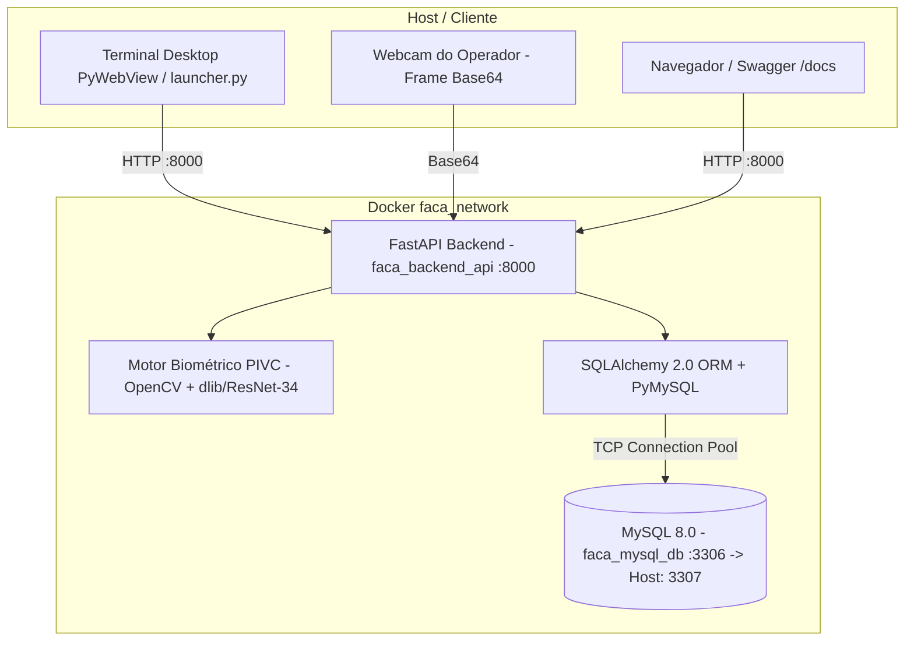

# Walkthrough da Integração: Backend F.A.C.A. + MySQL 8.0 Docker

Este documento consolida a arquitetura, as decisões de engenharia e os resultados obtidos na integração definitiva do Backend **FastAPI** com o banco de dados relacional **MySQL 8.0** em contêiner Docker na branch `feat/backend-banco`.

---

## 1. Visão Geral da Arquitetura Implementada



---

## 2. Estrutura dos Scripts SQL em `database/`

Os scripts foram organizados para execução automática e sequencial no entrypoint oficial do contêiner MySQL (`/docker-entrypoint-initdb.d`):

| Arquivo | Finalidade | Principais Entidades / Registros |
|---|---|---|
| [01_schema_base.sql](file:///c:/Users/Guilherme/Documents/APS/Semestres/6_semestre/aps-6semestre/database/01_schema_base.sql) | DDL oficial em 3FN | Criação das 10 tabelas relacionais (`divisao`, `cargo`, `nivel_acesso`, `usuario`, `toxina`, `documento`, `biometria`, `tentativa_autenticacao`, `bloqueio_login`, `auditoria`) e inserts dos níveis 1 a 3, divisões e cargos de referência. |
| [02_seed_operadores_e_cofre.sql](file:///c:/Users/Guilherme/Documents/APS/Semestres/6_semestre/aps-6semestre/database/02_seed_operadores_e_cofre.sql) | DML de carga inicial | **3 Operadores Oficiais** com status `ATIVA`, hash `PBKDF2-HMAC-SHA256` para `Faca@2026` e sem biometria prévia (para *enrollment on-the-fly*); **4 Toxinas controladas** classificadas por periculosidade; **5 Documentos técnicos** vinculados. |

> [!NOTE]
> O arquivo duplicado `database/db_aps.sql` foi removido para evitar dupla execução no primeiro boot do contêiner.

---

## 3. Módulos Desenvolvidos

### 3.1. Conexão Resiliente ([database.py](file:///c:/Users/Guilherme/Documents/APS/Semestres/6_semestre/aps-6semestre/database.py))
- **String de Conexão Inteligente:** lê `DATABASE_URL` do ambiente ou compõe a partir das variáveis individuais com fallback para o schema oficial `aps_biometria` e porta publicada `3307`.
- **Pool de Conexões:** configurada com `pool_pre_ping=True` (testa a conexão antes do uso, prevenindo *"MySQL server has gone away"*) e `pool_recycle=3600`.
- **Injeção de Dependência:** gerador `get_db()` tipado (`Generator[Session, None, None]`) para as rotas FastAPI.
- **Health Check SQL:** rotina `testar_conexao_sql()` executando `SELECT 1` para aferição instantânea no endpoint `/ping`.

### 3.2. Modelos ORM Tipados ([models.py](file:///c:/Users/Guilherme/Documents/APS/Semestres/6_semestre/aps-6semestre/models.py))
- Tipagem moderna do SQLAlchemy 2.0 (`Mapped[...]`, `mapped_column`, `relationship`).
- Relacionamentos bidirecionais com chaves estrangeiras restritas (`ON DELETE RESTRICT`).
- Relação 1:1 estrita entre `Usuario` e `Biometria` (`uselist=False`, `unique=True` em `id_usuario`).
- Coluna `modelo_facial` persistida como tipo `JSON` para armazenar o vetor de 128 floats da ResNet-34.

### 3.3. Repositório e Regras de Negócio ([crud.py](file:///c:/Users/Guilherme/Documents/APS/Semestres/6_semestre/aps-6semestre/crud.py))
- **Segurança Criptográfica:** hashing com `PBKDF2-HMAC-SHA256` (100.000 iterações, salt aleatório de 16 bytes), compatível com hashes SHA-256 puros.
- **Consultas Otimizadas:** `buscar_usuario()` com `joinedload` de cargo, divisão, nível de acesso e biometria, eliminando problemas de N+1 queries.
- **Política de 5 Tentativas e Bloqueio:**
  - Consulta `verificar_bloqueio_ativo()`, desativando automaticamente bloqueios expirados;
  - `contar_falhas_consecutivas()` contabiliza apenas falhas após o último sucesso ou desbloqueio;
  - Ao atingir 5 falhas, `aplicar_bloqueio_se_necessario()` cria entrada em `bloqueio_login` (15 min) e registra o evento na `auditoria`.
- **Enrollment On-the-Fly:** `salvar_biometria_usuario()` grava o vetor de 128 floats extraído pela webcam no 1º acesso e registra `ENROLLMENT_BIOMETRICO` na auditoria.
- **Salvaguarda de Desbloqueio:** `desbloquear_usuario()` desativa bloqueios vigentes e zera a sequência de falhas.

### 3.4. Servidor FastAPI Refatorado ([main.py](file:///c:/Users/Guilherme/Documents/APS/Semestres/6_semestre/aps-6semestre/main.py))
Substituição dos dicionários em memória pela persistência relacional MySQL:
- `POST /autenticar`: valida no MySQL, checa bloqueio, valida senha, executa as 5 fases do PIVC, realiza enrollment on-the-fly ou match facial 1:1, registra tentativas e auditoria.
- `POST /cadastrar`: registra novos servidores com foto de referência 128D no MySQL.
- `GET /toxinas`: rota protegida com filtro dinâmico RBAC por nível de acesso (Nível 1 vê nível 1 sem segredos; Nível 2 vê níveis 1 e 2 com detalhes; Nível 3 vê acesso total).
- `POST /usuarios/{identificador}/desbloquear`: salvaguarda operacional para emergências.
- `GET /ping`: retorna status da API e confirmação de conectividade com o MySQL.

---

## 4. Resultados da Bateria de Testes E2E ([tests/test_e2e_mysql.py](file:///c:/Users/Guilherme/Documents/APS/Semestres/6_semestre/aps-6semestre/tests/test_e2e_mysql.py))

A bateria de testes de integração ponta a ponta foi executada contra a API em execução no Docker e validou diretamente as tabelas físicas do contêiner MySQL:

```text
==============================================================================
BATERIA DE TESTES E2E — INTEGRAÇÃO F.A.C.A. + MYSQL 8.0 DOCKER
==============================================================================

[TESTE 1] Health Check da API e Conectividade MySQL...
  -> OK: /ping respondeu 200 com 'MySQL conectado'.

[TESTE 2] Consulta ao Cofre sem Token (Autenticação Obrigatória)...
  -> OK: /toxinas bloqueou acesso não autenticado com 401 TOKEN_INVALID_OR_EXPIRED.

[TESTE 3] 5 Falhas de Senha Consecutivas e Bloqueio Automático...
  -> Tentativa 1/5 falhou corretamente: 4 restantes.
  -> Tentativa 2/5 falhou corretamente: 3 restantes.
  -> Tentativa 3/5 falhou corretamente: 2 restantes.
  -> Tentativa 4/5 falhou corretamente: 1 restantes.
  -> OK: 5ª falha disparou 403 ACCOUNT_LOCKED.
  -> OK: Registro em bloqueio_login e auditoria confirmados no MySQL.

[TESTE 4] Tentativa de Autenticação com Conta Bloqueada...
  -> OK: Acesso barrado preventivamente (403) durante período de bloqueio.

[TESTE 5] Desbloqueio Administrativo de Emergência...
  -> OK: Bloqueio desativado no MySQL e log registrado em auditoria.

[TESTE 6] Primeiro Login do Operador 1 com Enrollment Biométrico On-the-Fly...
  -> OK: Operador 1 autenticado com sucesso! Token: mock-jwt-faca-wXMM5OwV8UB...
  -> OK: Vetor 128D e log de enrollment gravados com sucesso na tabela biometria do MySQL.

[TESTE 7] Segundo Login do Operador 1 (Verificação 1:1 contra Modelo no MySQL)...
  -> OK: Match facial 1:1 confirmado! Distância: 0.0000 | Confiança: 100.0%

[TESTE 8] Tentativa de Login com Rosto Divergente (Acesso Negado)...
  -> OK: Rosto divergente rejeitado com 401 FACE_NOT_RECOGNIZED e gravado no MySQL.

[TESTE 9] Consulta ao Cofre de Toxinas com Filtragem RBAC...
  -> OK: Operador Nível 1 visualizou apenas 1 toxina de Nível 1 sem segredos.
  -> OK: Diretora Nível 2 visualizou 3 toxinas (Nível 1 + Nível 2 com detalhes).
  -> OK: Ministro Nível 3 tem acesso total às 4 toxinas do cofre (incluindo Quimera FX-99).

[TESTE 10] Cadastro de Novo Servidor e Biometria no MySQL...
  -> OK: Novo servidor cadastrado com sucesso! ID: 5
  -> OK: Dados do novo servidor e vetor biométrico 128D confirmados no MySQL.
  -> OK: Conflito de unicidade de CPF validado com 409 CPF_ALREADY_EXISTS.

==============================================================================
TODOS OS 10 TESTES DE INTEGRAÇÃO PASSARAM COM SUCESSO! (Tempo: 5.54s)
==============================================================================
```

### Validação Estática (Pyright)
Execução do `npx pyright`:
```text
0 errors, 0 warnings, 0 informations
```
Todos os módulos (`database.py`, `models.py`, `crud.py`, `main.py`, `biometria.py`, `schemas.py`, `launcher.py` e `tests/test_e2e_mysql.py`) possuem tipagem estrita e zero inconsistências.

---

## 5. Guia Rápido de Uso para a Apresentação

### 5.1. Inicialização do Ambiente Completo
No terminal PowerShell da raiz do projeto:

```powershell
.\iniciar_faca.ps1
```
Este script:
1. Sobe os contêineres Docker (`faca_mysql_db` e `faca_backend_api`) via `docker compose up -d`;
2. Aguarda o health check do banco e da API;
3. Abre automaticamente a janela nativa do terminal desktop (PyWebView).

### 5.2. Credenciais dos Operadores Oficiais

| Operador | CPF | Senha | Nível RBAC | Divisão |
|---|---|---|---|---|
| **Guilherme Ferreira** | `12345678900` | `Faca@2026` | Nível 1 (Pesquisa/Operacional) | Toxicologia |
| **Dra. Júlia Fernandes** | `98765432100` | `Faca@2026` | Nível 2 (Diretoria) | Toxicologia |
| **Ministro do Meio Ambiente**| `11122233344` | `Faca@2026` | Nível 3 (Gabinete Ministerial) | Documentação |

> [!TIP]
> **Primeiro Acesso na Webcam:** Cada integrante pode autenticar com seu respectivo CPF e senha diante da webcam. Como os operadores foram semeados sem biometria prévia, o primeiro acesso grava a face do integrante no banco MySQL (*enrollment on-the-fly*). Em seguida, todos os acessos subsequentes verificarão 1:1 aquele mesmo rosto!

### 5.3. Rota de Salvaguarda (Desbloqueio de Emergência)
Caso alguma demonstração proposital de 5 erros bloqueie o CPF, utilize:
```bash
curl -X POST http://localhost:8000/usuarios/12345678900/desbloquear
```
Ou acione o endpoint correspondente via Swagger em `http://localhost:8000/docs`.
